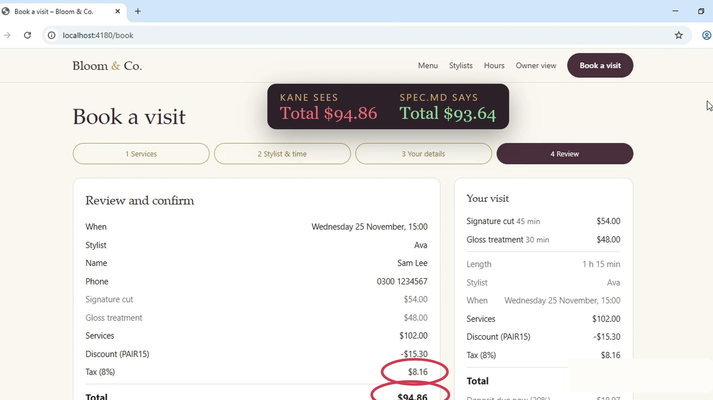
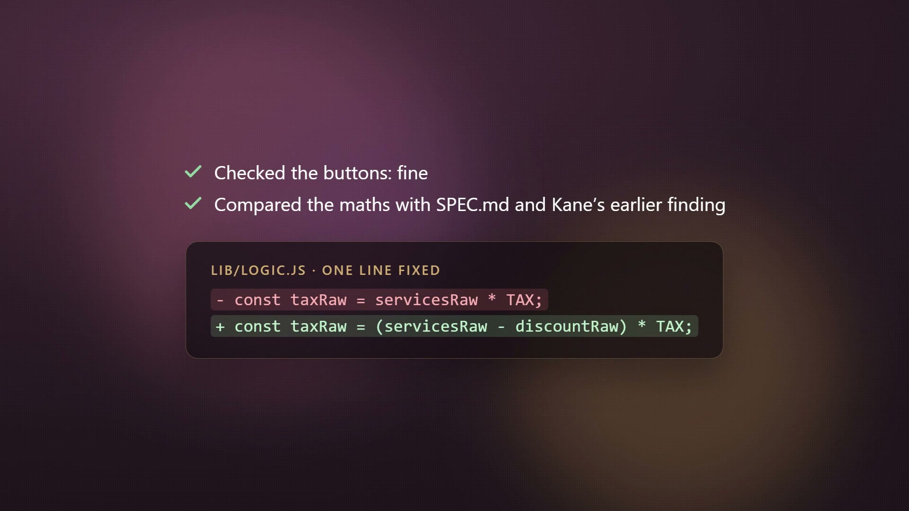
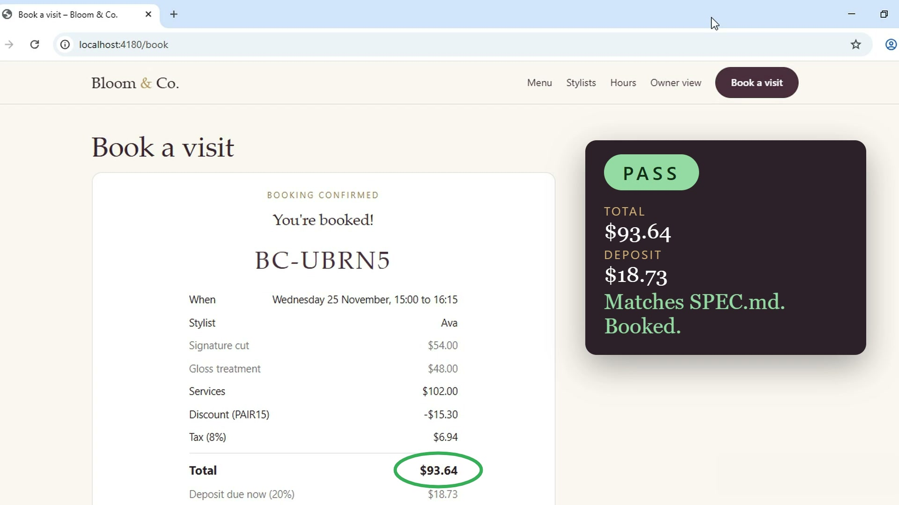
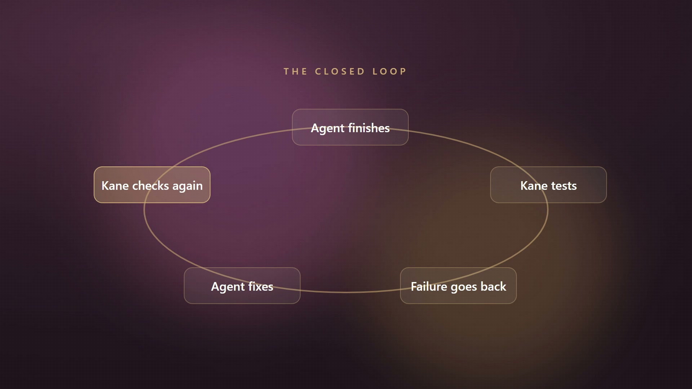
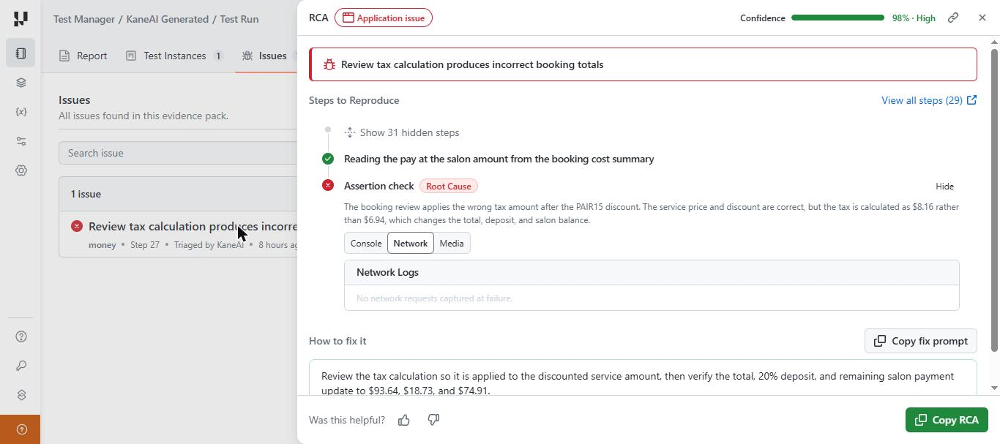

# ship-gate

A coding agent says "done". Before that counts, Kane CLI opens the site in a real browser and tries it like a customer.
If Kane finds a problem, its report goes straight back to the agent, which must fix it. The agent can only finish
once Kane passes.

Made for the KaneCLI Online Hackathon. Agent: Claude Code. Tester: Kane CLI.

## See it in one minute

- **Try the site live, no install:** https://shipgate-bloom-demo.vercel.app (the fixed version; demo bookings reset now and then)
- **Watch the loop (3 min):** https://youtu.be/Z-8XtzgDH3g
- **Check Kane's own records:** [Check our claims](#check-our-claims)

| 1. Kane catches the wrong total | 2. The agent fixes one line |
|---|---|
|  |  |
| **3. Kane runs the same booking again: pass** | **4. The loop** |
|  |  |

Screens 1 to 3 are from the demo video, which shows Kane's real run. Kane's own diagnosis of the bug is in [Check our claims](#check-our-claims).

## What is in here

| Part | What it is |
|---|---|
| `server.js`, `lib/`, `public/` | **Bloom & Co.**, a salon booking site (plain Node, no dependencies, no sign-in). Multi-service bookings, stylist price factors, promo codes, tax, deposit, opening hours, overlap rules, 24 h cancel rule, owner day totals. |
| `SPEC.md` | The rules of the site, written as a spec. Every Kane test is written from this file, never from the code. |
| `tests/*_test.md` | Kane tests in plain English (money maths, opening hours, back-to-back bookings and owner totals). |
| `scripts/kane-gate.js` + `.claude/settings.json` | The loop: a Claude Code **Stop hook**. When the agent tries to finish, it starts the site, runs the Kane tests, and on a real failure exits with code 2 and Kane's report, so Claude Code hands the failure back to the agent. Max 3 rounds. |
| `evidence/` | Honest notes of real Kane runs, including what Kane caught. |

## Check our claims

You don't have to trust the video. Three ways to check that Kane really did the testing:

1. **Kane's own pages, hosted by TestMu AI.** Every Kane run is stored in Kane's Test Manager. These share links open
   without a login and show Kane's step-by-step replay (press Autoplay):
   - [Money test, passed at 05:12 UTC on 17 Nov](https://test-manager.lambdatest.com/projects/01M7J7D50A5YQB5KXR2Z35T91F/test-cases/01M7KP6NSGKMAJMNYERTZ2X98S/dashboard/share/US_75ZYBQV324ODSN610ROVHZVVTAYXJ7RUY04T23NIPN15K0V3HLKWL83A2L3481AS?type=summary&agentView=true&fqdn=summary-page), right after the agent fixed the planted tax bug (run 5)
   - [Money test, passed at 05:59 UTC on 17 Nov](https://test-manager.lambdatest.com/projects/01M7J7D50A5YQB5KXR2Z35T91F/test-cases/01M7KP6NSGKMAJMNYERTZ2X98S/dashboard/share/US_UYJUCY0BY2T15X9U746QLMPBMTKQT14BXFB4V2JGAL8RV379G3XC9VXLMZ8FAITD?type=summary&agentView=true&fqdn=summary-page), the final recorded run (run 6)
2. **Kane's diagnosis of the failure.** Screenshot of Kane's own root-cause analysis for a failed gate run on the
   planted-bug version (17 Nov, 05:21-05:27 UTC): *"The booking review applies the wrong tax amount after the PAIR15 discount…
   tax is calculated as $8.16 rather than $6.94"*, with the fix it suggests ($93.64 total, as in `SPEC.md`).
   
   The full run is here too, exactly as Kane CLI 0.10.4 exported it from Test Manager:
   [`evidence/kane-run-tax-bug-caught.evidence`](evidence/kane-run-tax-bug-caught.evidence) (6 MB). It is a zip file:
   `run.yaml` and `failure.yaml` hold the verdict and times, `tests/money-*/` holds every step, screenshot, console and
   network log of the run. Rename it to `.zip` to look inside.
3. **Run it yourself.** The planted bug is still in the history (commits `902baaa`, `5e36da8`, `bc2c16a`, each marked
   "PLANTED BUG ON PURPOSE"). Check one out, start the site and run Kane (steps below): the money test should fail on the tax
   (Kane's first run of a test can also raise a noisy alarm, see Honest notes). On the latest commit it passes. The commit times line up with Kane's log in `evidence/`.

## Run the site

A live copy runs at https://shipgate-bloom-demo.vercel.app (Vercel runs `server.js` as it is; `vercel.json` adds the page files). To run it yourself:

```
node server.js
```

Open http://localhost:4173 (needs Node 18+). Pages: `/`, `/book`, `/owner`. No logins.
Set `SHIPGATE_NOW=2026-11-20T09:00:00` to fake the clock for the 24 h cancel rule.

## Run Kane on it yourself

```
npm i -g @testmuai/kane-cli
kane-cli login --oauth
PORT=4180 node server.js      # terminal 1: the tests expect port 4180
kane-cli testmd run tests/money_test.md --agent    # terminal 2
```

(On Windows PowerShell: `$env:PORT=4180; node server.js`.) Each test takes about 3 to 5 minutes.
Replace `money_test.md` with `hours_test.md` or `owner_test.md`.

## Switch on the loop

```
export KANE_GATE=1            # PowerShell: $env:KANE_GATE='1'
export KANE_CLI=kane-cli      # path to kane-cli if it is not on PATH
claude -p "add a Book now button to each stylist card linking to /book" --permission-mode acceptEdits --max-turns 30
```

Optional: `KANE_TESTS=tests/money_test.md` (comma-separated list), `KANE_HEADED=1` to watch the browser.
The gate is off unless `KANE_GATE=1`, so normal work is not slowed. Log: `recordings/gate-log.jsonl`.

## Honest notes

- **One bug was planted on purpose** for the demo (commit `902baaa`: tax charged before the discount, SPEC says after).
  The agent was never told about it. Kane found it from the spec alone and the agent fixed it from Kane's report alone
  (`evidence/rehearsal-1-loop.md`).
- Kane also caught a real slip of ours in the very first, simpler version of the site: the "You're booked!" box was
  visible before booking (`evidence/run1-kane-caught-bug.md`).
- On the full Bloom & Co. site Kane has found no natural bug so far; we only claim what the logs show.
- Kane's first report can be noise (for example an old test URL, or a page-load timeout it labels `environment_issue`).
  The gate retries environment issues once and never blames the site for them.
- Fallback if you cannot run it: the demo video and the logs in `evidence/`.
